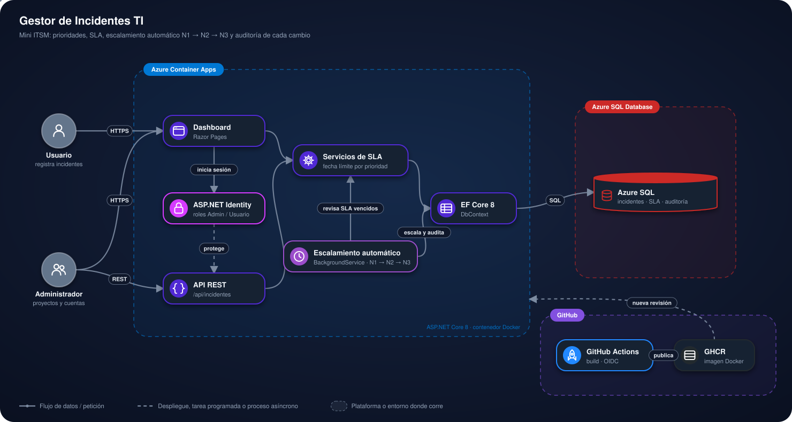

# Gestor de incidentes TI (mini ITSM)

<p>
  <a href="https://gestorincidentesti.livelywater-fe29fe0b.australiaeast.azurecontainerapps.io/"></a>
  <a href="https://frontend-nine-topaz-99.vercel.app"></a>
  <a href="https://d4i3vsgw7xwmh.cloudfront.net"></a>
</p>


> 📘 **[Manual de usuario](docs/MANUAL.md)**: cómo usar cada pantalla, paso a paso y con imágenes.

## Contenido

1. [Presentación](#1-presentación)
2. [Funcionalidades](#2-funcionalidades)
3. [Arquitectura](#3-arquitectura)
4. [Estructura del proyecto](#4-estructura-del-proyecto)
5. [Instalación para pruebas](#5-instalación-para-pruebas)
6. [Autor y licencia](#6-autor-y-licencia)

---

## 1. Presentación

Mesa de ayuda en **ASP.NET Core 10 / C#**: gestiona incidentes de soporte técnico con prioridad,
SLA, escalamiento automático N1 → N2 → N3 y trazabilidad completa de cada cambio de estado.

- **Qué hace:** alguien reporta una falla, el sistema le asigna una fecha límite según su
  prioridad y, si nadie la resuelve a tiempo, la escala sola al siguiente nivel de soporte.
- **Qué muestra:** un tablero con los incidentes abiertos, el porcentaje de cumplimiento del SLA y
  los vencidos, más el historial de cada cambio.
- **Cómo probarlo:** entra a la [demo](https://gestorincidentesti.livelywater-fe29fe0b.australiaeast.azurecontainerapps.io/),
  crea tu cuenta eligiendo un proyecto y explora los incidentes de ejemplo.

> C# / .NET no forma parte de mis certificaciones formales: es un proyecto autodidacta para llevar
> a código la experiencia real en gestión de incidentes, SLA e ITIL v4.

## 2. Funcionalidades

- Incidentes con categoría y subcategoría de un catálogo fijo, y prioridad calculada con la matriz
  ITIL impacto × urgencia.
- SLA de primera respuesta y de resolución en horario hábil con festivos de Colombia (la prioridad
  Crítica corre todo el tiempo); el estado **En espera** del solicitante detiene el reloj.
- Escalamiento automático al superar el umbral del SLA, con registro en el historial.
- Tablero de cumplimiento, avisos por correo e historial de auditoría.
- Registro e ingreso con verificación en dos pasos obligatoria y códigos de recuperación.
- Fechas y números en formato colombiano; adaptable a celular, tablet y computador.

## 3. Arquitectura

<p align="center">
  
</p>

| Capa | Tecnología |
|---|---|
| Aplicación | ASP.NET Core 10 (Razor Pages) |
| Datos | Entity Framework Core sobre SQL Server |
| SLA y escalamiento | Servicios propios que evalúan los vencidos cuando hay actividad |
| Pruebas | xUnit en cada cambio; pruebas E2E diarias con Playwright |
| Despliegue | Contenedor que se publica solo desde GitHub en cada cambio a `main` |

**Uso de recursos bajo demanda:** la aplicación y la base se suspenden sin visitas; el escalamiento
se evalúa cuando alguien entra, así no hay procesos que mantengan la base despierta.

## 4. Estructura del proyecto

```
src/GestorIncidentesTI/
├── Pages/        Dashboard, incidentes y cuenta (Razor Pages)
├── Services/     SLA, escalamiento y avisos
├── Models/       Entidades y enumeraciones
├── Data/         Contexto de la base
└── Program.cs
tests/            Pruebas unitarias (xUnit)
docs/             Manual de usuario y diagramas
```

## 5. Instalación para pruebas

1. Instala el [.NET 10 SDK](https://dotnet.microsoft.com/download) y una base SQL Server propia.
2. Copia `appsettings.Development.json.example` como `appsettings.Development.json` y pon ahí tu
   cadena de conexión (ese archivo no se sube al repositorio).
3. Desde `src/GestorIncidentesTI`: `dotnet restore`, `dotnet ef database update` y `dotnet run`.
4. Pruebas: `dotnet test` desde la raíz.

Antes de publicar cambios, revisa [SECURITY.md](SECURITY.md).

## 6. Autor y licencia

**Luis F. A.** · [GitHub](https://github.com/lariasca1994) · [LinkedIn](https://linkedin.com/in/lfac1)

Contacto: Telegram [@lfac6](https://t.me/lfac6) · WhatsApp [@carraian160](https://wa.me/carraian160) ·
[ariascluisf@hotmail.com](mailto:ariascluisf@hotmail.com)
