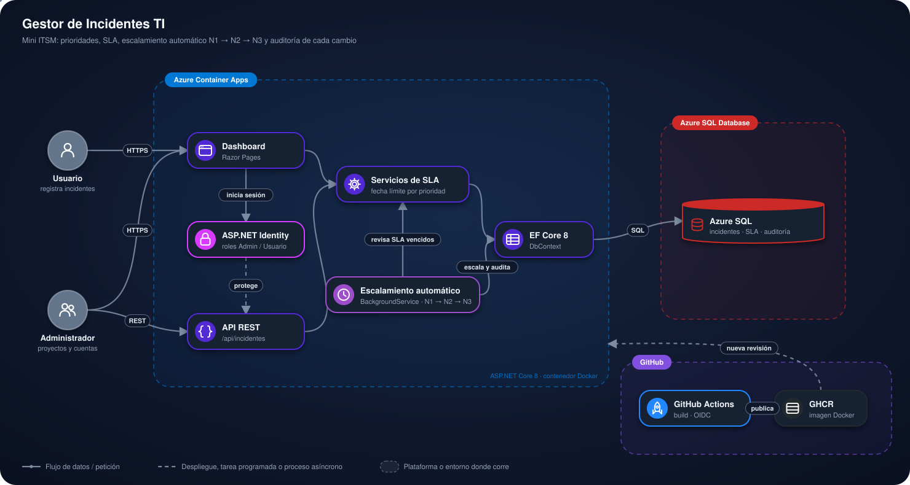

# Gestor de Incidentes TI (mini ITSM)

<p>
  <a href="https://gestorincidentesti.livelywater-fe29fe0b.australiaeast.azurecontainerapps.io/"></a>
  <a href="https://frontend-nine-topaz-99.vercel.app"></a>
  <a href="https://d4i3vsgw7xwmh.cloudfront.net"></a>
</p>


## Contenido

1. [Presentación](#1-presentación)
2. [Estructura del proyecto](#2-estructura-del-proyecto)
3. [Arquitectura](#3-arquitectura)
4. [Plataformas y su función](#4-plataformas-y-su-función)
5. [Cómo usar la plataforma](#5-cómo-usar-la-plataforma)
6. [Instalación para pruebas](#6-instalación-para-pruebas)
7. [Autor y licencia](#7-autor-y-licencia)

---

## 1. Presentación

Proyecto de práctica en **ASP.NET Core 10 / C#**. Gestiona incidentes de soporte técnico con
prioridad, SLA, escalamiento automático N1 → N2 → N3 y trazabilidad completa de cada cambio
de estado.

### En pocas palabras

- **Qué hace:** es una mesa de ayuda. Alguien reporta una falla (un
  *incidente*), el sistema le asigna una fecha límite según su prioridad y, si
  nadie lo resuelve a tiempo, lo **escala solo** al siguiente nivel de soporte
  (N1 → N2 → N3).
- **Qué muestra:** un tablero con los incidentes abiertos, el porcentaje de
  cumplimiento de SLA y los vencidos, más el historial de cada cambio.
- **Cómo probarlo:** entra a la [demo](https://gestorincidentesti.livelywater-fe29fe0b.australiaeast.azurecontainerapps.io/),
  crea tu cuenta en **Register** eligiendo un proyecto y explora los incidentes
  de ejemplo. Para correrlo en tu equipo, ve a
  [Instalación para pruebas](#6-instalación-para-pruebas).

> Nota: C# / .NET no forma parte de mis certificaciones formales actuales — este es un
> proyecto autodidacta para aplicar en código la experiencia real en gestión de incidentes,
> SLA e ITIL v4.

### Demo en vivo

**Aplicación:** [abrir la demo en vivo](https://gestorincidentesti.livelywater-fe29fe0b.australiaeast.azurecontainerapps.io/)

### Funcionalidades

- Registro de incidentes con categoría y subcategoría de un catálogo fijo y prioridad calculada
  con la matriz ITIL impacto × urgencia
- SLA de primera respuesta y de resolución, en horario hábil con festivos de Colombia
  (la prioridad Crítica corre 24×7)
- Estado **En espera** del solicitante que detiene el reloj del SLA
- Escalamiento automático cuando se supera el umbral de tiempo de SLA (se evalúa al entrar al aplicativo)
- Avisos por correo al crear, resolver o cerrar incidentes y al crear proyectos
- Dashboard con incidentes abiertos, % de cumplimiento de SLA y SLA incumplidos
- Historial de auditoría por cada cambio de estado o nivel
- Verificación en dos pasos obligatoria: app autenticadora o código por correo, a elección; el
  otro método se agrega desde **Seguridad**

### Stack

| Capa | Tecnología |
|---|---|
| Backend | ASP.NET Core 10 (Web API + Razor Pages) |
| ORM | Entity Framework Core 10 |
| Base de datos | SQL Server / Azure SQL |
| Escalamiento | Middleware bajo demanda (sin procesos en segundo plano que mantengan la base despierta) |
| Correo | API transaccional de Brevo |

### Datos de prueba

La aplicación ya cuenta con proyectos e incidentes de ejemplo para evaluar el flujo completo
sin necesidad de crear datos manualmente: distintos estados (abierto, en progreso, escalado,
resuelto, cerrado) y niveles de cumplimiento de SLA (a tiempo, en riesgo, vencido), repartidos
en proyectos temáticos de infraestructura y desarrollo (red, cloud, identidad, monitoreo,
facturación, entre otros).

---

## 2. Estructura del proyecto

```
GestorIncidentesTI/
├── GestorIncidentesTI.sln
└── src/GestorIncidentesTI/
    ├── Controllers/       # API REST
    ├── Data/               # DbContext + seed de SLA
    ├── Models/             # Entidades, enums y DTOs
    ├── Pages/              # Dashboard (Razor Pages)
    ├── Services/           # Lógica de SLA y escalamiento
    └── Program.cs
```

---

## 3. Arquitectura

<p align="center">
  
</p>

- El dashboard (Razor Pages) y la API REST están protegidos con ASP.NET Identity.
- Los **servicios de SLA** calculan la fecha límite de cada incidente. Los
  vencidos se revisan y escalan cuando alguien entra al aplicativo (como máximo
  cada 5 minutos), dejando registro en la auditoría; sin visitas no hay
  consultas y la base puede pausarse.
- **EF Core 8** guarda todo en la base SQL Server.

### Uso de recursos bajo demanda

- La aplicación se apaga sin visitas (unos 5 minutos después de la última petición) y no
  consume nada. La primera visita tarda unos segundos en arrancar.
- La base se pausa sola tras 60 minutos sin consultas.
- La app solo consulta la base cuando alguien entra: al abrir el inicio de sesión o al
  navegar con sesión iniciada. Ahí siembra roles y cuentas administradoras (una vez por
  arranque) y evalúa los escalamientos de SLA (como máximo cada 5 minutos). La landing
  pública no toca la base, así que los bots y monitores no la despiertan.

### Avisos por correo y Telegram

Cada vez que se **crea un incidente**, se **resuelve o cierra** uno, o se **crea un
proyecto**, llega un correo a quien hizo la gestión y a los administradores
(`Notificaciones__Admins__N`). El correo usa la paleta del sitio, ordena los datos clave
(proyecto, estado, prioridad, nivel, SLA, quién lo gestionó) y muestra en **Notas** lo que
escribió el usuario: la descripción al crear y el comentario al resolver o cerrar.

Se envía con la API transaccional de **Brevo**: la API
key va en el secret `Brevo__ApiKey` de la Container App y el remitente
(`Brevo__RemitenteEmail`) debe estar verificado en Brevo. Si el envío falla, la gestión se
guarda igual y el error queda en el log. Sin API key (por ejemplo, en local) solo se
registra en el log.

El mismo aviso llega también por **Telegram**, resumido y con un botón para abrir el
incidente, si están configurados `TELEGRAM_BOT_TOKEN` (secret) y `TELEGRAM_CHAT_ID`. Correo y
Telegram se envían por separado: si uno falla, el otro sale igual.

### Seguridad y estado

- **Al día en seguridad:** el runtime, el sistema y las dependencias se mantienen con los últimos
  parches y se revisan periódicamente.
- Identity y acceso por proyecto protegen API, dashboard y administración.
- Verificación en dos pasos obligatoria (TOTP o código por correo con Brevo), con bloqueo de 15
  minutos tras 5 códigos errados y sin reutilizar códigos.
- Antes de publicar, lee [SECURITY.md](SECURITY.md) y ejecuta `git status` para comprobar
  que no se incluyen configuraciones locales, secretos, datos de prueba, `.vs`, `bin` u `obj`.
- Las pruebas E2E corren en [qa-evidencia](https://d4i3vsgw7xwmh.cloudfront.net) de lunes a
  viernes a las 11:00 y 17:00 (hora Bogotá): hasta el 31 de octubre de 2026 solo en la de
  las 11:00, desde noviembre en ambas. Faltan pruebas unitarias.

---

## 4. Plataformas y su función

| Plataforma | Función en el proyecto |
|---|---|
|  | Corre la aplicación ASP.NET Core 10: el dashboard (Razor Pages) y la API REST. Escala a cero sin visitas. |
|  | Guarda proyectos, incidentes, usuarios, SLA y auditoría. Es serverless: se pausa sola sin consultas. |
|  | Envía los avisos por correo al crear, resolver o cerrar incidentes y al crear proyectos. |
|  | Envía el mismo aviso resumido, con un botón para abrir el incidente (opcional). |
|  | Construye la imagen, la publica en GitHub Container Registry y actualiza la Container App con OpenID Connect, sin secretos de publicación. |
|  | Prueba la demo automáticamente y publica la evidencia. |

---

## 5. Cómo usar la plataforma

### 5.1 Crear una cuenta

1. En el menú, pulsa **Register** (o **Register as a new user** desde el inicio de sesión).
2. Completa el formulario:

   | Campo | Dato |
   |---|---|
   | Email | Correo con el que vas a iniciar sesión |
   | Proyecto | Proyecto al que perteneces, de la lista |
   | Password / Confirm Password | Contraseña y su confirmación |

3. Pulsa **Register**. La cuenta queda con rol **Usuario** dentro del proyecto elegido.
4. Elige tu verificación en dos pasos: **App autenticadora** (escanea el QR y escribe el primer
   código) o **Código por correo**, y pulsa **Activar**.

### 5.2 Iniciar sesión

1. Pulsa **Iniciar sesión**, escribe tu correo y contraseña y pulsa **Ingresar**.
2. Escribe el código de 6 dígitos de tu app autenticadora (o el que llega por correo) y pulsa
   **Verificar**. En **Seguridad** puedes agregar el otro método y elegir cuál se pide por defecto.
3. Si olvidaste la contraseña, usa **¿Olvidaste tu contraseña?**.
4. El menú muestra **Dashboard**, **Incidentes** y, para administradores, **Proyectos**.

### 5.3 Ver el dashboard

**Dashboard de Incidentes** muestra los incidentes abiertos, el porcentaje de cumplimiento de
SLA y los vencidos, con su **Título**, **Prioridad**, **Estado**, **Nivel** y **SLA**.

### 5.4 Reportar un incidente

1. En **Incidentes**, pulsa **+ Nuevo incidente**.
2. Completa el formulario:

   | Campo | Dato |
   |---|---|
   | Proyecto | Proyecto afectado |
   | Título | Resumen de la falla |
   | Descripción | Qué pasó y cómo se manifiesta |
   | Categoría y Subcategoría | Tipo de falla, de una lista fija (Hardware › Impresora, Red y conectividad › VPN…) |
   | Impacto | A cuántos afecta: una persona, varias o toda el área |
   | Urgencia | Qué tan rápido se necesita: puede esperar, hay alternativa o el trabajo está detenido |
   | Solicitante | Quién reporta la falla |

   La **prioridad** no se elige: la calcula la matriz impacto × urgencia y se muestra al
   llenar el formulario.

   | Impacto ↓ · Urgencia → | Alta | Media | Baja |
   |---|---|---|---|
   | Alto | Crítica | Alta | Media |
   | Medio | Alta | Media | Baja |
   | Bajo | Media | Baja | Baja |

3. Pulsa **Crear incidente**. El sistema calcula los plazos de primera respuesta y de
   resolución según la prioridad. La Crítica corre 24×7; las demás solo en horario hábil
   (lunes a viernes de 8:00 a 18:00 hora Bogotá, sin festivos de Colombia):

   | Prioridad | Respuesta | Resolución | Escala al consumir |
   |---|---|---|---|
   | Crítica | 1 h | 4 h | 70 % del plazo |
   | Alta | 2 h | 8 h | 75 % del plazo |
   | Media | 4 h | 24 h | 80 % del plazo |
   | Baja | 8 h | 72 h | 85 % del plazo |

### 5.5 Dar seguimiento a un incidente

1. En la lista de **Incidentes**, pulsa **Ver**.
2. En **Cambiar estado**, elige el **Nuevo estado** (En progreso, En espera, Escalado,
   Resuelto o Cerrado), escribe un comentario si quieres y pulsa **Actualizar estado**.
   **En espera** es para cuando falta información del solicitante: el SLA se detiene y, al
   volver a **En progreso**, la fecha límite se corre lo que duró la espera.
3. En **Agregar comentario**, escribe y pulsa **Comentar**. El primer cambio de estado, o el
   primer comentario de alguien distinto a quien lo reportó, cuenta como primera respuesta.
4. El **Historial** muestra cada cambio con su fecha y comentario, incluidos los
   escalamientos automáticos N1 → N2 → N3.

### 5.6 Usuarios, roles y proyectos

Cualquier persona crea su cuenta desde **Register**. El administrador no crea usuarios:
**asigna los recursos**, es decir, crea los proyectos a los que cada cuenta se une.

- **Admin:** ve y gestiona todo, de todos los proyectos, y es el único que crea proyectos
  desde **Proyectos** → **Nuevo proyecto** (**Nombre** y **Descripción**).
- **Usuario:** se crea solo desde **Register** (`/Identity/Account/Register`), eligiendo
  el proyecto al que pertenece. Desde ahí registra, comenta y da seguimiento a los incidentes
  de su proyecto.

**Cómo se crean las cuentas Admin:** son fijas. Se definen en los secrets
`UsuariosAdmin__N__Email` / `UsuariosAdmin__N__Password` de la Container App, y la app las
crea o repara (contraseña, rol, desbloqueo) cada vez que arranca y alguien entra. Son las
únicas con rol Admin: si otra cuenta lo tuviera, pasa a Usuario. Una de ellas es la cuenta de
pruebas automáticas (qa-evidencia).

---

## 6. Instalación para pruebas

1. Instala el [.NET 10 SDK](https://dotnet.microsoft.com/download) (10.0.402 o posterior) y SQL Server (o usa el
   contenedor: `docker run -e "ACCEPT_EULA=Y" -e "SA_PASSWORD=TuPasswordAqui" -p 1433:1433 -d mcr.microsoft.com/mssql/server:2022-latest`).
2. Copia `appsettings.Development.json.example` a `appsettings.Development.json` y pon tu
   connection string real ahí (ese archivo está en `.gitignore`, nunca se sube).
3. Restaura y aplica migraciones:
```bash
   cd src/GestorIncidentesTI
   dotnet restore
   dotnet ef migrations add InicialSchema
   dotnet ef database update
```
4. Corre la app:
```bash
   dotnet run
```
5. Dashboard en `https://localhost:5001`, API en `https://localhost:5001/api/incidentes`.

### Despliegue en Azure

La aplicación corre en **Azure Container Apps**, con la imagen publicada en GitHub Container
Registry, y la base de datos en Azure SQL Database. La base existente no se recrea al iniciar.

1. Las migraciones se aplican solas en la primera visita después de un despliegue (al abrir el
   inicio de sesión o navegar con sesión), la misma que ya despierta la base: no hay pasos
   manuales ni un despertar extra. Solo agregan columnas o tablas y preservan los datos.
2. En esa misma visita se depura lo que no sirve: los incidentes de la prueba automática de QA
   se conservan 15 días y luego se borran con su historial, para que la base no crezca.
3. Cada push a `main` dispara `.github/workflows/ghcr-publish.yml`: construye la imagen, la
   publica en GitHub Container Registry con la etiqueta del commit y actualiza la Container App.
   No hace falta redesplegar a mano. La autenticación con Azure usa OpenID Connect, sin
   secretos, con una identidad que solo puede actualizar esta Container App.
4. `ConnectionStrings__Default`, `AdminSeed__Email` y `AdminSeed__Password` viven como
   secrets de la Container App y no se guardan en el repositorio.

---

## 7. Autor y licencia

> 📘 **[Manual de usuario](docs/MANUAL.md)**: cómo usar la plataforma campo por campo, qué datos se ingresan y qué garantiza en seguridad.

**Luis Felipe Arias Carriazo**
[GitHub](https://github.com/lariasca1994) · [LinkedIn](https://linkedin.com/in/lfac1)

Licencia: MIT.
