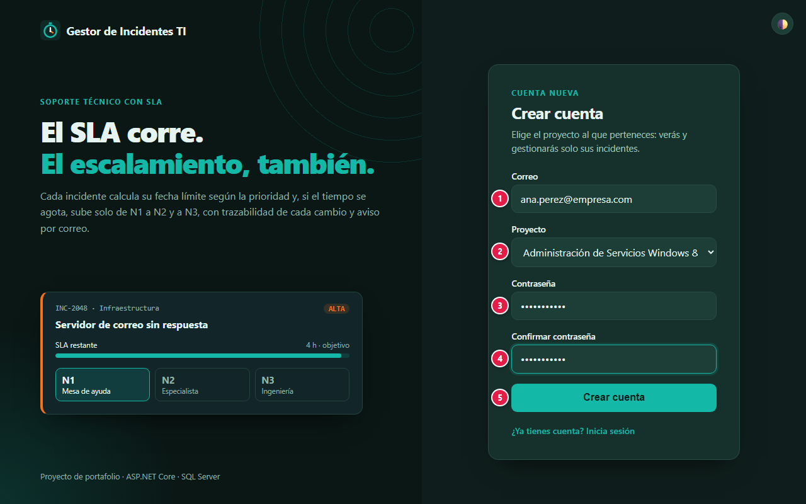
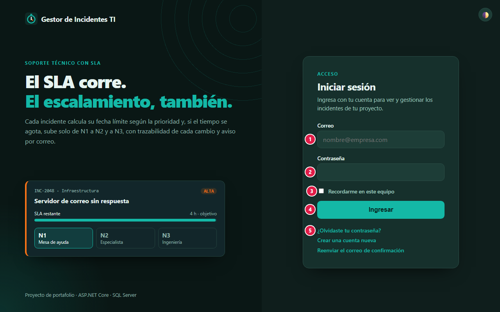
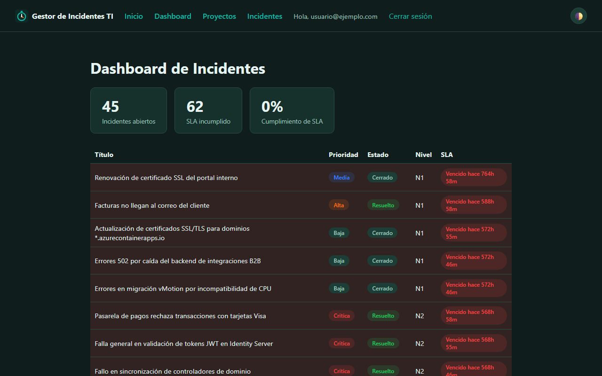
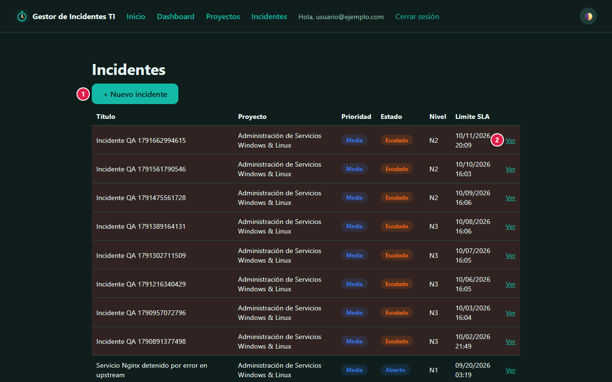
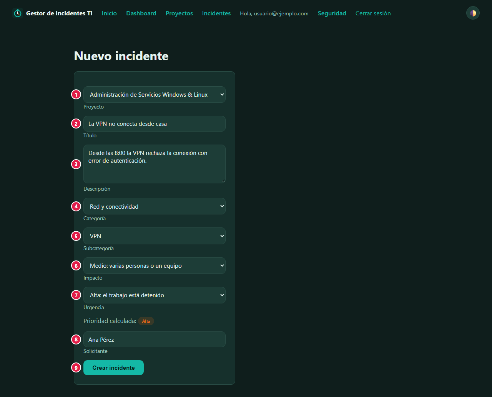
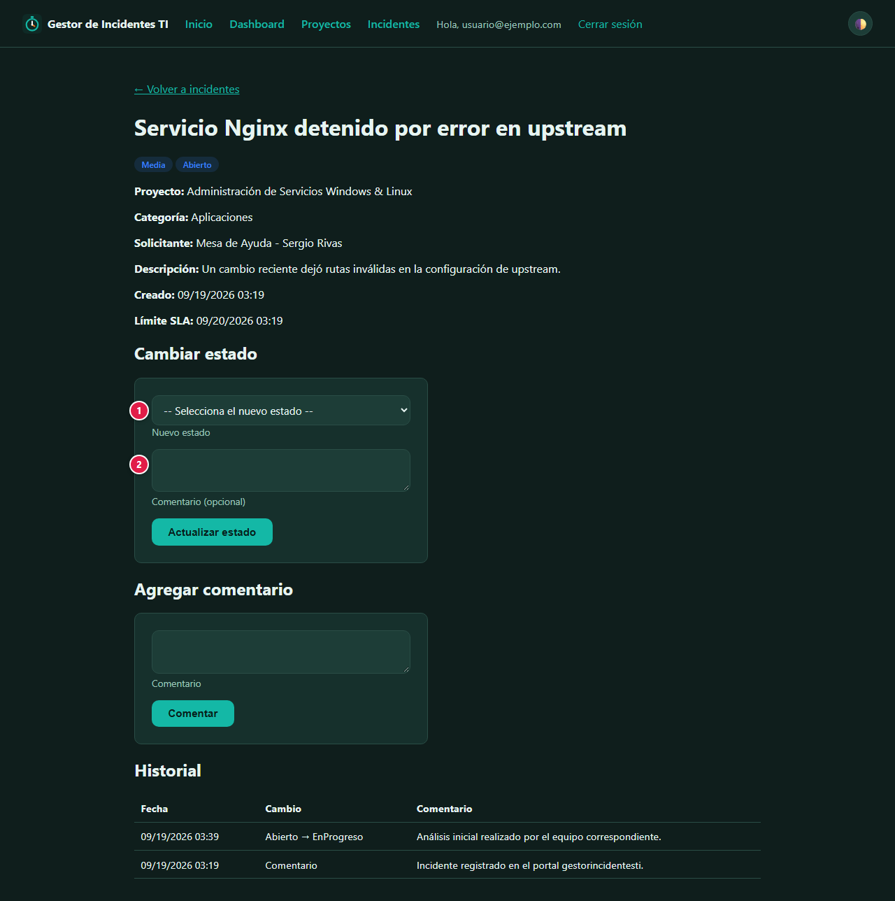
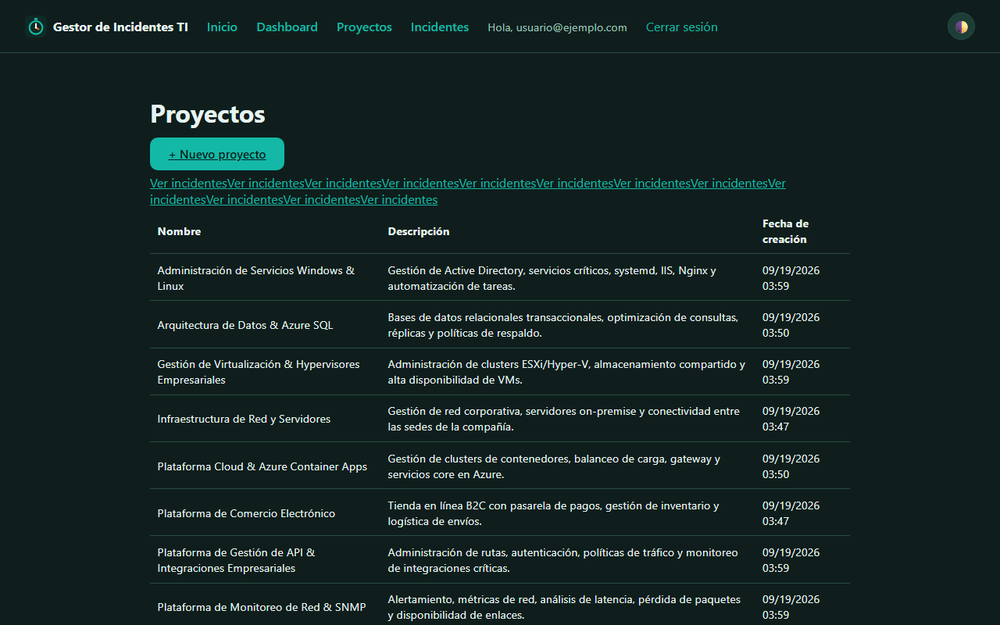

# 📘 Manual de usuario · Gestor de Incidentes TI

Guía para usar la plataforma paso a paso: qué significa cada campo, qué datos se ingresan y qué
protege la plataforma. Para la parte técnica vuelve al [README](../README.md).

**Demo:** [Gestor de Incidentes TI (Azure Container Apps)](https://gestorincidentesti.livelywater-fe29fe0b.australiaeast.azurecontainerapps.io/)

## Contenido

1. [Proyecto: objetivos y alcances](#1-proyecto-objetivos-y-alcances)
2. [Glosario](#2-glosario)
3. [Plataformas, base de datos y servicios](#3-plataformas-base-de-datos-y-servicios)
4. [Paso a paso](#4-paso-a-paso)
5. [Seguridad: tu información protegida](#5-seguridad-tu-información-protegida)
6. [Agradecimientos](#6-agradecimientos)

---

## 1. Proyecto: objetivos y alcances

### Objetivo

Una mesa de ayuda: alguien reporta una falla (un **incidente**), el sistema le calcula una fecha
límite según su prioridad (**SLA**) y, si no se resuelve a tiempo, lo **escala solo** al siguiente
nivel de soporte: N1 → N2 → N3. Cada cambio queda en el historial.

### Alcance: qué necesitas y qué esperar

- Solo necesitas un navegador.
- La aplicación y su base de datos se apagan sin uso. Si ves **"El servicio está en una ventana de
  mantenimiento"**, la base se está encendiendo: espera uno o dos minutos y pulsa **Reintentar**.
  Ningún dato se pierde.
- Las capturas de este manual se tomaron con una cuenta **Admin**, que ve todos los proyectos. Una
  cuenta normal ve solo los incidentes de su proyecto.

### Límites

Es una demo de portafolio:

- **La recuperación de contraseña no envía correos reales** (el envío de Identity está simulado):
  guarda tu contraseña en un gestor.
- No hay bloqueo de cuenta por intentos fallidos ni segundo factor activo.
- No registres datos personales reales en los incidentes: las cuentas del mismo proyecto los ven.
- Usa **Recordarme en este equipo** solo en dispositivos personales.

## 2. Glosario

Palabras técnicas que aparecen en este manual, explicadas en lenguaje simple.

| Término | Qué significa |
|---|---|
| **Administrador** | Cuenta con permisos para gestionar usuarios y configuraciones de la aplicación. |
| **API** | Puerta de entrada de un programa para que otros programas le pidan o le envíen datos. |
| **Base de datos** | Lugar donde la aplicación guarda la información de forma ordenada y permanente. |
| **Captura de pantalla (evidencia)** | Imagen de lo que se veía en la pantalla, que sirve como prueba de lo que pasó. |
| **Cifrado / TLS / HTTPS** | Protección que codifica la información mientras viaja, para que nadie en el camino pueda leerla. |
| **Contraseña cifrada (hash)** | La contraseña no se guarda tal cual, sino como una "huella" de la que no se puede recuperar el texto original. |
| **Cookie** | Pequeño dato que el navegador guarda para recordar tu sesión en ese sitio. |
| **Escalamiento (N1 → N2 → N3)** | Pasar un caso a un nivel de soporte con más experiencia cuando el nivel actual no lo resuelve. |
| **Incidente** | Falla o interrupción de un servicio que hay que atender. |
| **MFA (segundo factor)** | Verificación adicional a la contraseña, como un código de 6 dígitos, para confirmar que eres tú. |
| **Modo mantenimiento** | Pantalla que aparece cuando el servicio o su base de datos no responden; se recupera sola cuando vuelven. |
| **Navegador** | Programa con el que abres páginas web: Chrome, Edge, Firefox, Safari. |
| **Nube** | Servidores de una empresa (Amazon, Microsoft, Google, Oracle…) donde la aplicación funciona sin depender de un computador propio. |
| **Rate limit (límite de intentos)** | Tope de intentos en poco tiempo, para frenar a quien intenta adivinar contraseñas. |
| **REST** | Forma estándar de organizar una API usando direcciones web y métodos como GET o POST. |
| **Rol** | Tipo de cuenta que define qué puede hacer cada persona (por ejemplo, usuario o administrador). |
| **Servidor** | Computador en la nube que atiende las peticiones de la aplicación. |
| **Sesión** | El tiempo en que la aplicación te reconoce después de iniciar sesión, sin pedirte la contraseña de nuevo. |
| **SLA** | Tiempo máximo acordado para atender o resolver un caso. |
| **Token** | Credencial temporal que la aplicación te entrega al iniciar sesión, en lugar de enviar tu contraseña en cada paso. |
| **Variables de entorno / secretos** | Claves y contraseñas internas de la aplicación, guardadas fuera del código para que no queden expuestas. |

## 3. Plataformas, base de datos y servicios

Qué servicio de nube, base de datos o API usa el proyecto y para qué sirve cada uno.

| Plataforma | Tipo | Qué hace en el proyecto |
|---|---|---|
|  | Nube | Corre la aplicación ASP.NET Core 10: el dashboard (Razor Pages) y la API REST. Escala a cero sin visitas. |
|  | Base de datos | Guarda proyectos, incidentes, usuarios, SLA y auditoría. Es serverless: se pausa sola sin consultas. |
|  | API / servicio externo | Envía los avisos por correo al crear, resolver o cerrar incidentes y al crear proyectos. |
|  | API / servicio externo | Envía el mismo aviso resumido, con un botón para abrir el incidente (opcional). |
|  | Automatización | Construye la imagen, la publica en GitHub Container Registry y actualiza la Container App con OpenID Connect, sin secretos de publicación. |
|  | Pruebas automatizadas | Prueba la demo automáticamente y publica la evidencia. |

## 4. Paso a paso

### 4.1 Crear una cuenta

| # | Campo | Qué escribir | Reglas |
|:-:|---|---|---|
| 1 | Correo | El correo con el que vas a entrar | Formato válido y único |
| 2 | Proyecto | El proyecto al que perteneces | Solo verás y gestionarás los incidentes de ese proyecto |
| 3 | Contraseña | Tu contraseña | Mínimo 6 caracteres, con al menos una mayúscula, una minúscula y un número |
| 4 | Confirmar contraseña | La misma contraseña | Debe coincidir con el campo 3 |
| 5 | Crear cuenta | Botón | Crea la cuenta con rol **Usuario** |

El rol **Admin** no se puede pedir desde el formulario: las cuentas administradoras son fijas y se
configuran en el servidor.

### 4.2 Iniciar sesión

| # | Campo | Qué escribir |
|:-:|---|---|
| 1 | Correo | El correo de tu cuenta |
| 2 | Contraseña | Tu contraseña |
| 3 | Recordarme en este equipo | Márcalo solo en tu equipo personal: la sesión se mantiene al cerrar el navegador |
| 4 | Ingresar | Entra a la aplicación |
| 5 | ¿Olvidaste tu contraseña? | Inicia la recuperación (ver [Límites](#1-proyecto-objetivos-y-alcances)) |

### 4.3 Dashboard

| Indicador | Qué significa |
|---|---|
| Incidentes abiertos | Incidentes que aún no se han resuelto ni cerrado |
| SLA incumplido | Incidentes que pasaron su fecha límite |
| Cumplimiento de SLA | Porcentaje de incidentes atendidos dentro del plazo |

La tabla muestra cada incidente con su **Prioridad**, **Estado**, **Nivel** (N1, N2 o N3) y el
tiempo restante o vencido de su **SLA**.

### 4.4 Incidentes

| # | Elemento | Qué hace |
|:-:|---|---|
| 1 | + Nuevo incidente | Abre el formulario para reportar una falla |
| 2 | Ver | Abre el detalle del incidente |

### 4.5 Reportar un incidente

| # | Campo | Qué escribir |
|:-:|---|---|
| 1 | Proyecto | Proyecto afectado (solo el Admin elige; un Usuario reporta en su propio proyecto) |
| 2 | Título | Resumen corto de la falla |
| 3 | Descripción | Qué pasó, desde cuándo y cómo se manifiesta |
| 4 | Categoría | Tipo de falla: Red, Aplicaciones, Infraestructura… |
| 5 | Prioridad | Baja, Media, Alta o Crítica; define el plazo del SLA |
| 6 | Solicitante | Quién reporta la falla |
| 7 | Crear incidente | Guarda el incidente y calcula su fecha límite |

Plazos por prioridad:

| Prioridad | Respuesta | Resolución | Escala al consumir |
|---|---|---|---|
| Crítica | 1 h | 4 h | 70 % del plazo |
| Alta | 2 h | 8 h | 75 % del plazo |
| Media | 4 h | 24 h | 80 % del plazo |
| Baja | 8 h | 72 h | 85 % del plazo |

### 4.6 Dar seguimiento a un incidente

| # | Campo | Qué escribir |
|:-:|---|---|
| 1 | Nuevo estado | Abierto, En progreso, Escalado, Resuelto o Cerrado; pulsa **Actualizar estado** |
| 2 | Comentario (opcional) | Qué se hizo o por qué cambia el estado |

En **Agregar comentario** dejas notas sin cambiar el estado. El **Historial** registra cada cambio
con fecha y comentario, incluidos los escalamientos automáticos.

### 4.7 Proyectos (solo Admin)

El administrador crea los proyectos a los que se unen las cuentas, con **Nombre** y
**Descripción**. No crea usuarios: cada persona se registra sola.

### 4.8 Preguntas frecuentes

**¿Por qué no veo todos los incidentes?** Una cuenta Usuario solo ve los de su proyecto.

**¿Quién escala los incidentes?** El sistema, cada vez que alguien entra a la aplicación: revisa
los plazos y sube de nivel los que superaron su umbral.

**¿Puedo cambiarme de proyecto?** No desde la aplicación; crea una cuenta nueva eligiendo el otro
proyecto.

## 5. Seguridad: tu información protegida

Tu confianza es lo primero: la plataforma solo pide los datos necesarios para funcionar, los protege y no los comparte con terceros. Esto es lo que se guarda y cómo se protege.

### Qué datos se guardan y dónde

| Dato | Para qué se usa | Dónde se guarda | Quién lo ve |
|---|---|---|---|
| Correo | Identificar tu cuenta y avisarte | Azure SQL | Tú y los administradores |
| Contraseña | Iniciar sesión | Azure SQL, **solo su huella** (PBKDF2 de ASP.NET Identity) | Nadie: no se puede leer ni recuperar |
| Proyecto | Limitar lo que ves | Azure SQL | Tú y los administradores |
| Incidentes, comentarios y nombre del solicitante | Gestionar la falla | Azure SQL | Las cuentas del mismo proyecto y los administradores |
| Sesión | Mantenerte conectado | Cookie de tu navegador | Cifrada por el servidor e invisible para JavaScript |

### Cómo se protege tu información

Comprobado en el código del proyecto (`Program.cs`, `Controllers/IncidentesController.cs`,
`Pages/`):

- **ASP.NET Core Identity** para las cuentas: contraseñas con PBKDF2 y sal propia por usuario.
- **Cookie de sesión `HttpOnly`** protegida por el servidor; sin sesión, toda página interna
  redirige al inicio de sesión.
- **Aislamiento por proyecto:** el dashboard, la lista, el detalle y la API filtran por el proyecto
  de la cuenta. Cambiar el identificador en la URL no muestra incidentes de otros proyectos.
- **Roles en el servidor:** solo el rol Admin entra a **Proyectos**. Las cuentas Admin son fijas,
  se definen como secretos del servidor y cualquier otra cuenta con ese rol vuelve a ser Usuario.
- **Protección contra CSRF:** los formularios de Razor Pages llevan y validan un token antifalsificación.
- **HTTPS obligatorio** con redirección y HSTS en producción.
- **Historial de auditoría** de cada cambio de estado o nivel.
- **Secretos fuera del repositorio:** la cadena de conexión, las cuentas Admin y la clave de Brevo
  viven en los secretos de la Container App.

## 6. Agradecimientos

A mi familia, por su apoyo incondicional, su paciencia y por creer en cada proyecto incluso cuando apenas era una idea. Este trabajo también es de ustedes.

Y a ti, que usas esta plataforma: cada prueba, comentario y sugerencia ayuda a que siga mejorando.
