# 📘 Manual de usuario · Gestor de incidentes TI

## 1. Portada

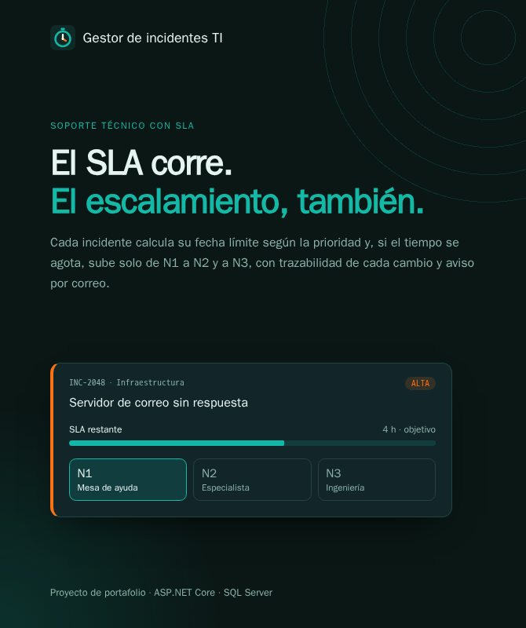

| | |
|---|---|
| **Producto** | Gestor de incidentes TI |
| **Documento** | Manual de usuario |
| **Versión** | 2.0 · noviembre de 2026 |
| **Dirigido a** | Mesas de ayuda, especialistas de soporte (N1, N2 y N3) y coordinadores |
| **Dirección** | [Gestor de incidentes TI](https://gestorincidentesti.livelywater-fe29fe0b.australiaeast.azurecontainerapps.io/) |
| **Autor** | Luis F. A. |

## Contenido

1. [Portada](#1-portada)
2. [Introducción](#2-introducción)
3. [Objetivo](#3-objetivo)
4. [Alcance](#4-alcance)
5. [Acceso al sistema](#5-acceso-al-sistema)
6. [Pantalla principal](#6-pantalla-principal)
7. [Navegación](#7-navegación)
8. [Funcionalidades](#8-funcionalidades)
9. [Gestión de perfil](#9-gestión-de-perfil)
10. [Mensajes frecuentes](#10-mensajes-frecuentes)
11. [Preguntas frecuentes](#11-preguntas-frecuentes)
12. [Glosario](#12-glosario)

---

## 2. Introducción

El **Gestor de incidentes TI** registra las fallas que reportan los usuarios, calcula su prioridad
a partir del impacto y la urgencia, y le asigna un **SLA** (tiempo máximo de atención). Si el tiempo
se agota, el incidente **sube solo de nivel**, de N1 a N2 y a N3, con trazabilidad de cada cambio y
aviso por correo.

Este manual explica cada pantalla, paso a paso y con imágenes.

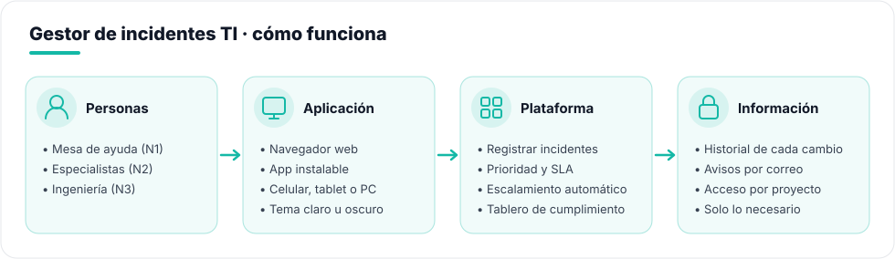

## 3. Objetivo

Que cualquier persona del equipo de soporte pueda, sin conocimientos técnicos:

- Crear su cuenta e ingresar de forma segura.
- Registrar incidentes con la información necesaria para atenderlos.
- Seguir su estado, cambiarlo y dejar comentarios.
- Ver en un tablero el cumplimiento del SLA y los incidentes en riesgo.

## 4. Alcance

**Incluye:** registro e ingreso con verificación en dos pasos y códigos de recuperación, registro de
incidentes con prioridad calculada, SLA en horario hábil, escalamiento automático N1 → N2 → N3,
cambio de estado con comentarios, historial y tablero de cumplimiento.

**No incluye:** inventario de equipos ni chat en vivo.

**Qué necesitas:** un navegador actualizado, conexión a internet, un correo propio y una app
autenticadora en el celular (o acceso a tu correo para recibir códigos).

## 5. Acceso al sistema

### 5.1 Crear una cuenta

En la pantalla de ingreso pulsa **Crear una cuenta nueva**.

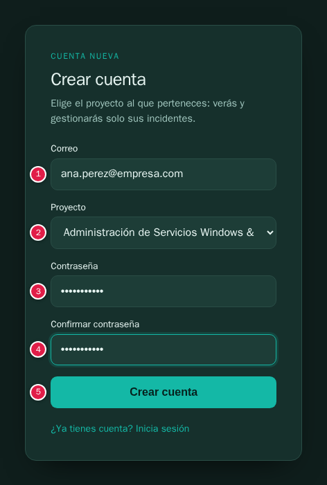

| # | Campo | Qué escribir |
|:-:|---|---|
| 1 | Correo | Un correo al que tengas acceso |
| 2 | Proyecto | El proyecto o área en la que trabajas |
| 3 | Contraseña | Una contraseña segura |
| 4 | Confirmar contraseña | La misma contraseña |
| 5 | Crear cuenta | Crea tu cuenta y te lleva a configurar la verificación en dos pasos |

### 5.2 Iniciar sesión

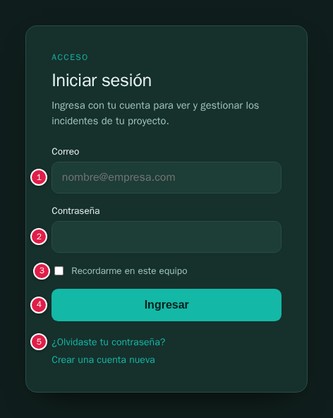

| # | Elemento | Qué hace |
|:-:|---|---|
| 1 | Correo | El correo de tu cuenta |
| 2 | Contraseña | Tu contraseña |
| 3 | Recordarme en este equipo | Mantiene la sesión en ese equipo; no lo marques en equipos compartidos |
| 4 | Ingresar | Comprueba tus datos y pasa a la verificación en dos pasos |
| 5 | ¿Olvidaste tu contraseña? | Abre la recuperación de contraseña (5.4) |

### 5.3 Verificación en dos pasos

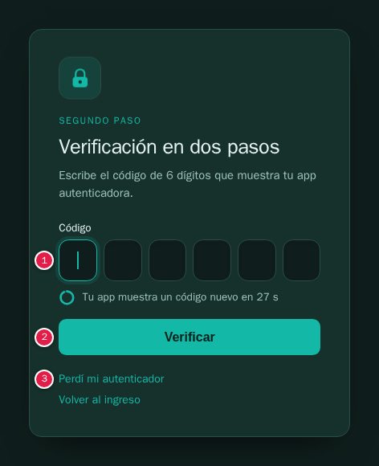

| # | Elemento | Qué hace |
|:-:|---|---|
| 1 | Código | Los 6 dígitos de tu app (o de tu correo); el anillo indica cuánto falta para el siguiente código |
| 2 | Verificar | Confirma el código y abre la plataforma |
| 3 | Perdí mi autenticador | Si ya no tienes la app, recuperas el acceso con un código al correo o con un código de recuperación |

### 5.4 Recuperar la contraseña

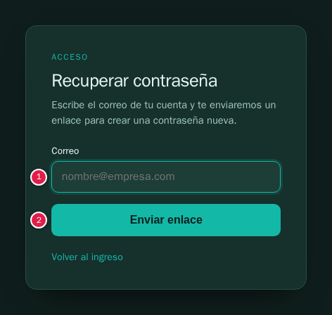

| # | Elemento | Qué hace |
|:-:|---|---|
| 1 | Correo | El correo de tu cuenta |
| 2 | Enviar enlace | Envía un enlace para crear una contraseña nueva (vence en poco tiempo y sirve una sola vez) |

## 6. Pantalla principal

**Dashboard** muestra el estado de todos los incidentes abiertos.

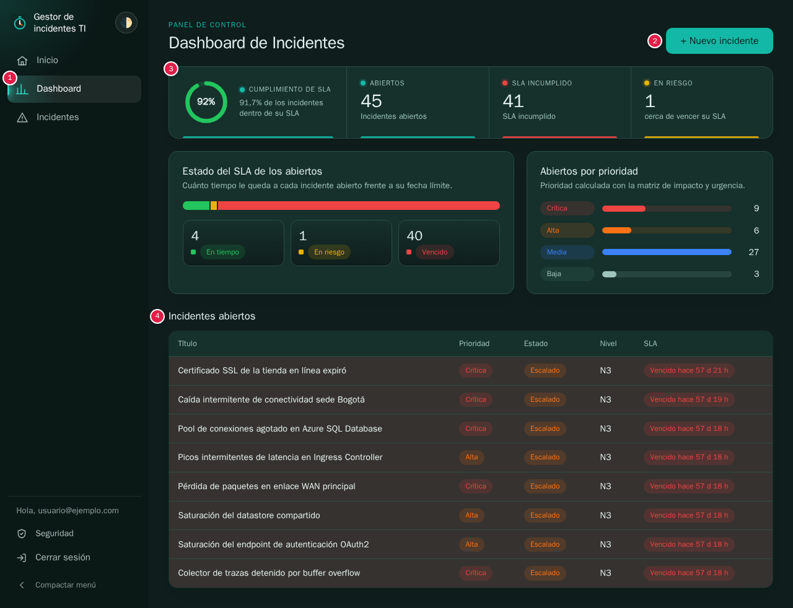

| # | Elemento | Qué hace |
|:-:|---|---|
| 1 | Menú lateral | Lleva a Inicio, Dashboard e Incidentes |
| 2 | + Nuevo incidente | Registra un incidente (8.1) |
| 3 | Indicadores | Cumplimiento del SLA, abiertos, SLA incumplido y en riesgo |
| 4 | Incidentes abiertos | Cada uno con prioridad, estado, nivel y tiempo restante (o vencido) del SLA |

## 7. Navegación

En el computador el menú está a la izquierda; **Compactar menú** lo reduce a íconos. Al pie están
**Seguridad** y **Cerrar sesión**.

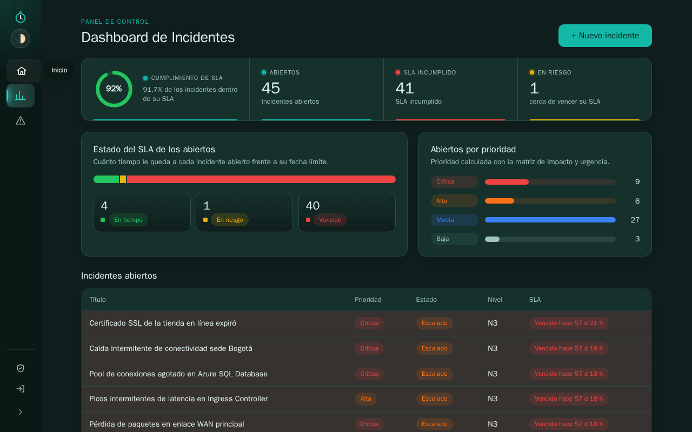

En la tablet en vertical y en el celular, el menú pasa a una barra inferior; **Más** abre las
opciones de la cuenta. El botón ◐ cambia entre tema claro y oscuro.

| Tablet en vertical | Celular con la hoja "Más" |
|:-:|:-:|
| 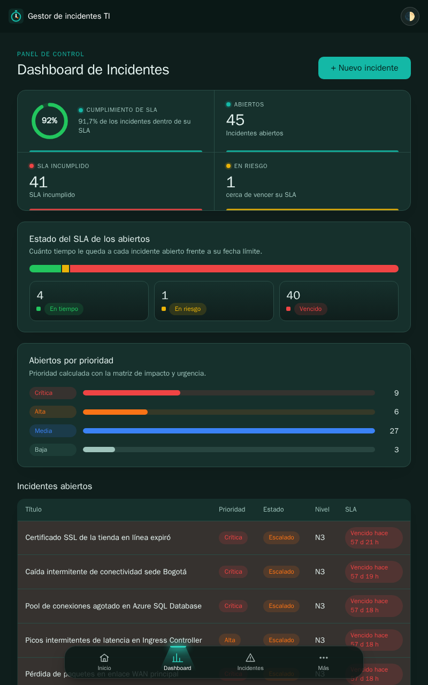 | 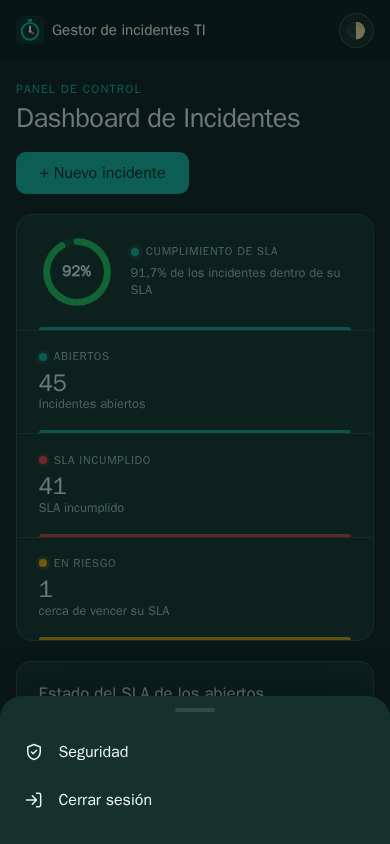 |

## 8. Funcionalidades

### 8.1 Crear: registrar un incidente

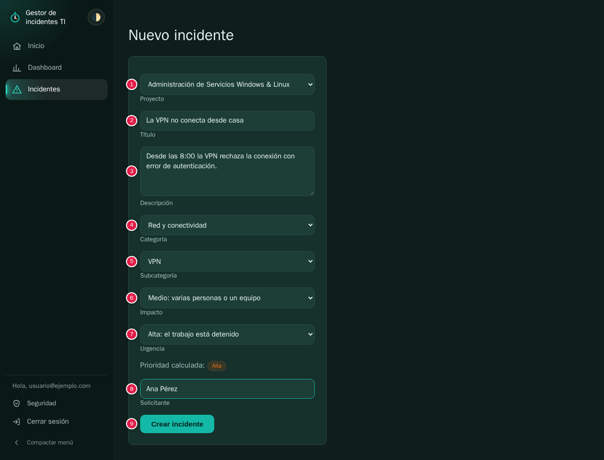

| # | Campo | Qué escribir |
|:-:|---|---|
| 1 | Proyecto | El proyecto afectado |
| 2 | Título | Un resumen corto de la falla |
| 3 | Descripción | Qué pasa, desde cuándo y qué se intentó |
| 4 | Categoría | Tipo de falla (red, aplicaciones, hardware…) |
| 5 | Subcategoría | El detalle de la categoría |
| 6 | Impacto | A cuántas personas o servicios afecta |
| 7 | Urgencia | Qué tan rápido se necesita la solución |
| 8 | Solicitante | Quién reporta la falla |
| 9 | Crear incidente | Registra el incidente; la prioridad y el SLA se calculan solos |

La **prioridad** sale de la matriz de impacto y urgencia (Crítica, Alta, Media o Baja), y el **SLA**
se cuenta en horario hábil (lunes a viernes de 8:00 a 18:00, sin festivos), salvo los críticos.

### 8.2 Consultar: lista de incidentes

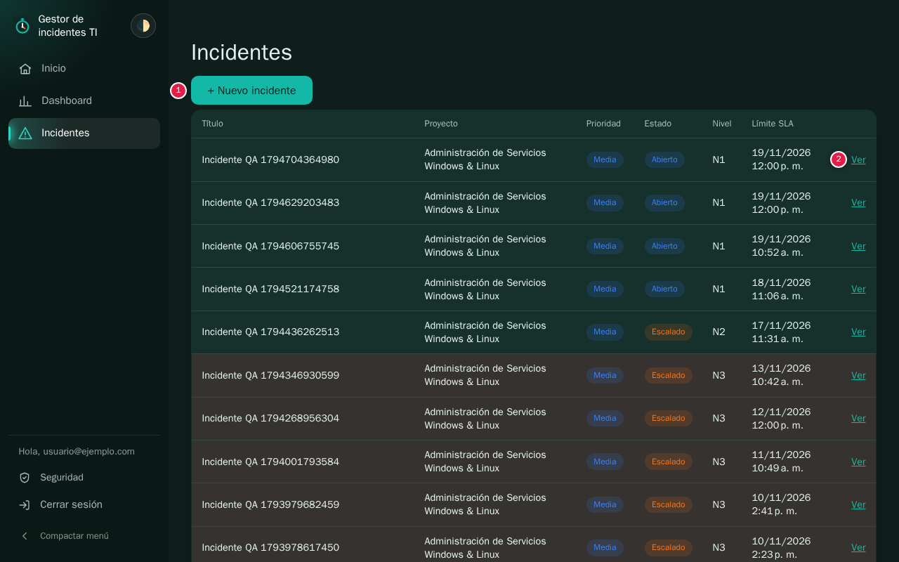

| # | Elemento | Qué hace |
|:-:|---|---|
| 1 | + Nuevo incidente | Registra un incidente |
| 2 | Ver | Abre el detalle del incidente |

### 8.3 Modificar: cambiar el estado y comentar

En el detalle del incidente ves sus datos, el límite del SLA y el historial completo.

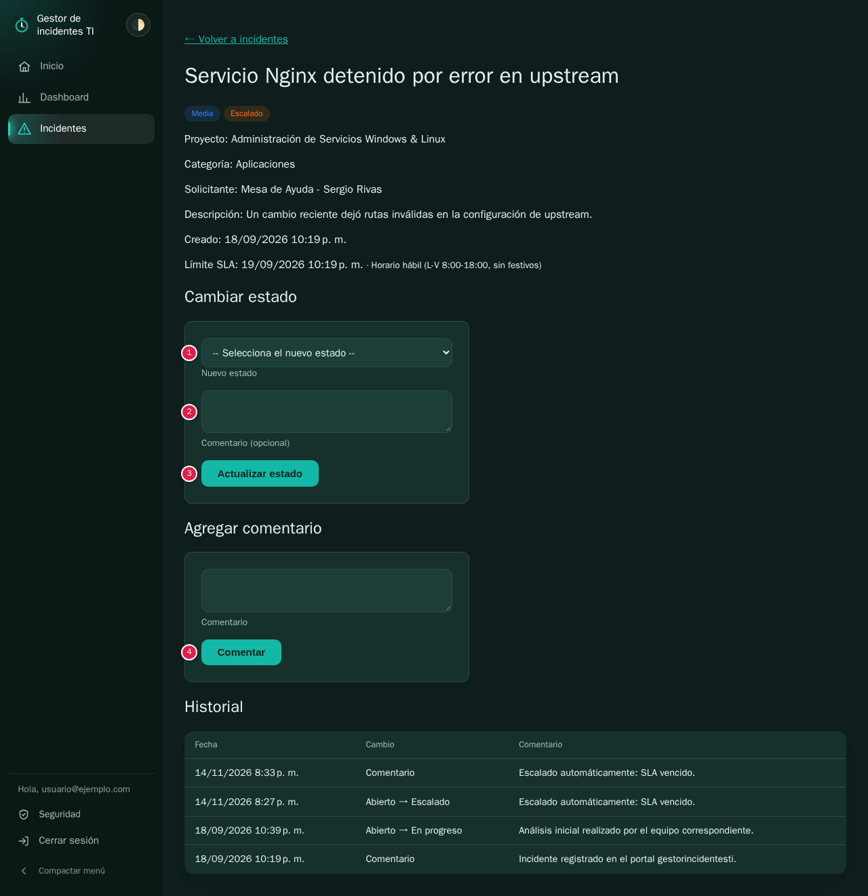

| # | Elemento | Qué hace |
|:-:|---|---|
| 1 | Nuevo estado | Elige el siguiente estado permitido (por ejemplo, En progreso o Resuelto) |
| 2 | Comentario (opcional) | Explica el cambio |
| 3 | Actualizar estado | Guarda el cambio y lo registra en el historial |
| 4 | Comentar | Agrega un comentario sin cambiar el estado |

Si el SLA se vence, el incidente **escala solo** al siguiente nivel y el historial lo registra.

### 8.4 Reportar: cumplimiento y riesgo

El tablero resume el estado del servicio:

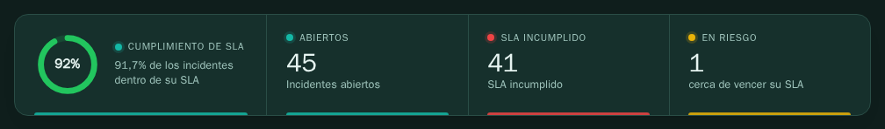

| Indicador | Qué mide |
|---|---|
| Cumplimiento de SLA | Porcentaje de incidentes atendidos dentro de su SLA |
| Abiertos | Incidentes que todavía no se cierran |
| SLA incumplido | Incidentes que superaron su tiempo |
| En riesgo | Incidentes cerca de vencer su SLA |

| Estado del SLA de los abiertos | Abiertos por prioridad |
|:-:|:-:|
| 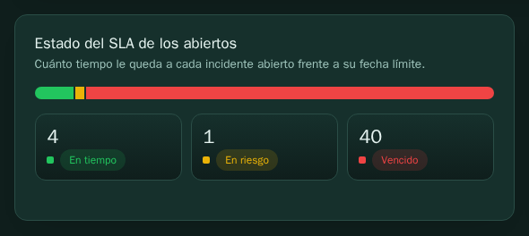 | 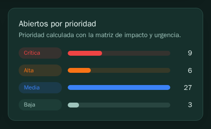 |

## 9. Gestión de perfil

### 9.1 Seguridad

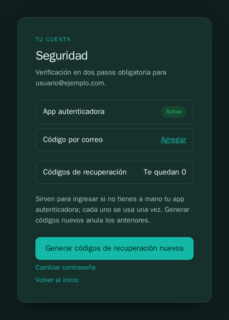

Desde **Seguridad** ves tus métodos de verificación, agregas el código por correo, generas
**códigos de recuperación** (cada uno sirve una vez y los nuevos anulan los anteriores) y llegas a
**Cambiar contraseña**.

### 9.2 Cambiar contraseña

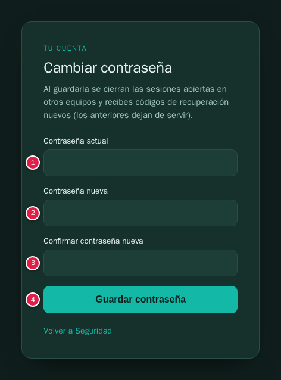

| # | Campo | Qué escribir |
|:-:|---|---|
| 1 | Contraseña actual | Tu contraseña de hoy |
| 2 | Contraseña nueva | La contraseña nueva |
| 3 | Confirmar contraseña nueva | La misma contraseña nueva |
| 4 | Guardar contraseña | Guarda el cambio |

## 10. Mensajes frecuentes

| Mensaje | Qué significa | Qué hacer |
|---|---|---|
| Correo o contraseña incorrectos. | Los datos no coinciden | Revísalos o usa **¿Olvidaste tu contraseña?** |
| El código de recuperación no es correcto o ya se usó. | Ese código ya no sirve | Usa otro de tus códigos de recuperación |
| Debes seleccionar un proyecto. | Falta el proyecto | Elige uno de la lista |
| Indica el impacto. / Indica la urgencia. | Falta un dato para calcular la prioridad | Elige el valor |
| Esa transición de estado no está permitida. | El estado elegido no sigue del actual | Elige un estado de la lista |
| Incidente creado. | El incidente quedó registrado | Búscalo en la lista |
| Generamos códigos de recuperación nuevos; los anteriores ya no sirven. | Se crearon códigos nuevos | Guárdalos en un lugar seguro |
| Página no encontrada | La dirección que abriste no existe | Vuelve con el menú |
| Sin conexión | Tu equipo no tiene internet | La pantalla reintenta sola |

| Página no encontrada | Sin conexión |
|:-:|:-:|
| 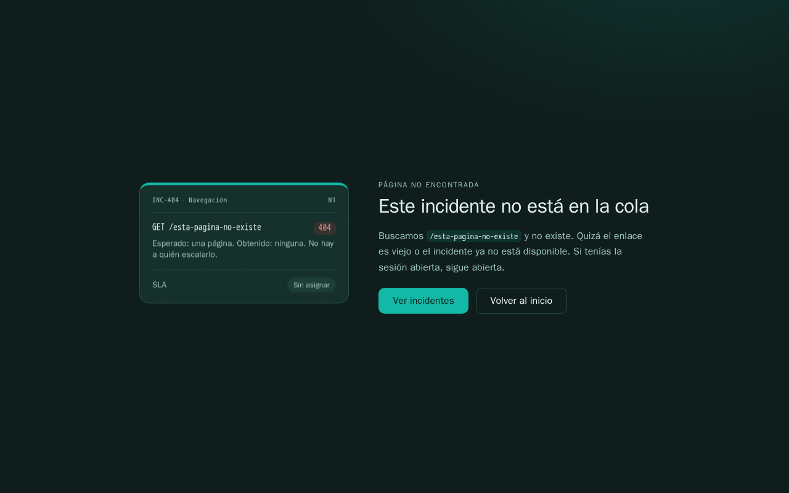 | 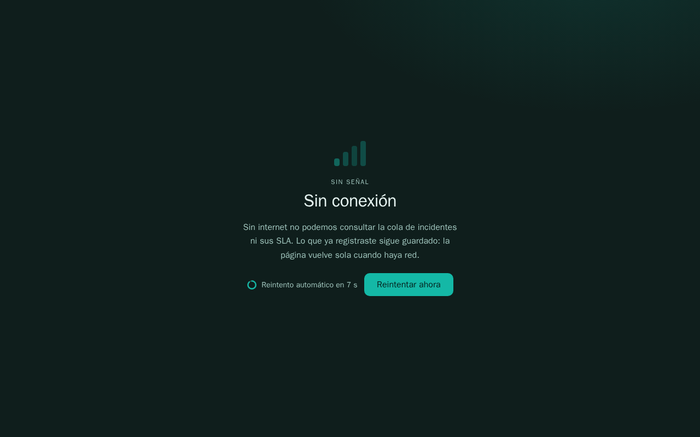 |

## 11. Preguntas frecuentes

**¿Por qué a veces aparece "En mantenimiento" al entrar?** El servicio se suspende cuando nadie lo
usa y tarda unos minutos en reactivarse. La pantalla reintenta sola.

**¿Por qué mi incidente subió de nivel?** Se venció su SLA: el escalamiento es automático.

**¿Cómo se cuenta el SLA?** En horario hábil (lunes a viernes de 8:00 a 18:00, sin festivos),
excepto los incidentes críticos, que cuentan todo el tiempo.

**¿Se puede instalar como aplicación?** Sí: en Chrome o Edge, **Instalar aplicación**; en iPhone,
Safari → **Compartir → Agregar a inicio**.

**¿Dónde pido ayuda o reporto un problema?** Telegram [@lfac6](https://t.me/lfac6), WhatsApp
[@carraian160](https://wa.me/carraian160) o [ariascluisf@hotmail.com](mailto:ariascluisf@hotmail.com).

## 12. Glosario

| Término | Qué significa |
|---|---|
| **Escalamiento** | Paso de un incidente al siguiente nivel de soporte (N1 → N2 → N3) |
| **Impacto** | A cuántas personas o servicios afecta la falla |
| **Incidente** | Una falla o interrupción de un servicio |
| **N1, N2, N3** | Niveles de soporte: mesa de ayuda, especialistas e ingeniería |
| **Prioridad** | Qué tan rápido debe atenderse, según impacto y urgencia |
| **SLA** | Tiempo máximo acordado para atender un incidente |
| **Urgencia** | Qué tan pronto se necesita la solución |
| **Verificación en dos pasos** | Además de la contraseña, se pide un código que solo tú puedes recibir |
